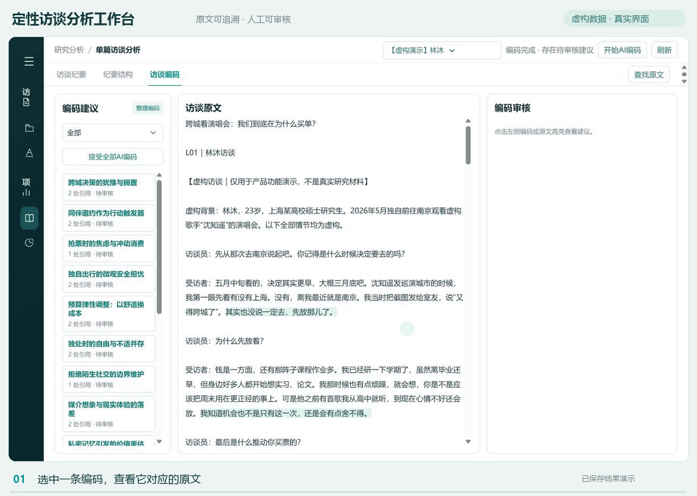

# 定性访谈分析工作台

面向定性研究的 AI 辅助整理、分析与原文回查工具。AI 提出初步建议，研究者对照材料审核、修订并保留最终判断权。



[高清演示视频](docs/demo/workbench-demo.mp4)

> 动画使用明确标注的虚构访谈，展示已保存的实际分析结果与真实界面。光标及转场为后期编排，不代表模型实时响应速度或结果已通过人工审核。

## 功能

- 访谈材料与研究项目管理，导入 TXT、DOCX。
- AI 文字修订与单篇访谈纪要。
- 单篇开放式编码、原文高亮、多处引用、手动新增及人工审核。
- 单篇编码整理：检查疑似重复、定义边界及粒度差异，人工决定合并或保留，支持保护性撤销。
- 跨访谈主题研究：复用话题索引，提取具体表述、归纳发现并回查来源。
- 词语探索：和弦图、关联排行、共现矩阵及话题块与完整原文回查。
- 分批任务记录、已完成结果保留及有限失败恢复。

这些功能不是必须顺序执行的流水线；无需先完成编码才能开展主题研究。

## 快速开始

当前发布候选版基于 Windows 与 Python 3.12。源码仍有 Windows 注册表和语音环境路径依赖，不宣称已适配 macOS/Linux。

在 PowerShell 中，从仓库目录执行：

```powershell
py -3.12 -m venv .venv
.\.venv\Scripts\python.exe -m pip install -r requirements.txt
.\.venv\Scripts\python.exe run.py
```

浏览器访问 `http://127.0.0.1:8765/`。如端口已被已有工作台占用，请先停止已有服务，避免误用其他目录中的研究数据。

默认不附带任何研究项目或分析结果。可在“访谈资料”中新建项目，导入 `examples/concert/` 的四篇虚构访谈开始体验。演示文件仅有两处已说明的文字修正；不包含真实受访者资料。

## 模型配置

材料导入和页面浏览无需 API 密钥；AI 操作需要你自己的模型服务账户。运行前在同一个 PowerShell 窗口设置：

```powershell
$env:DEEPSEEK_API_KEY = "填写你自己的密钥"
$env:QWEN_API_KEY = "填写你自己的密钥"
$env:QWEN_BASE_URL = "填写你确认可信的千问兼容服务地址"
.\.venv\Scripts\python.exe run.py
```

不要把真实值写入源码、README、截图或提交记录。`.env.example` 只是配置说明，程序不会自动读取 `.env`。现有 DeepSeek 操作使用其 API 配置；开放式编码、整理和索引/主题研究使用 `indexed_theme.py` 中指定的兼容模型。模型名称需与你的服务账户支持项一致，可能需要自行调整。

设置密钥并点击 AI 分析后，相应访谈内容会发送给你配置的服务商。先确认服务地址、数据处理条款及访谈使用授权；“原文存储在本地”不等于“AI 分析完全离线”。发布包不携带原作者使用的兼容服务地址。

## 录音转录与音频对齐

录音处理还依赖 Qwen3-ASR、FunASR、PyTorch、SoundFile、FFmpeg 及本地模型，不在轻量文本分析依赖中。模型、权重、虚拟环境和缓存均未打包。相关代码保留了独立语音环境目录约定，需要另行配置；当前快速开始不保证录音转录与对齐可直接运行。

## 结果与质量边界

- AI 编码默认待审核；引用校验失败会标记需处理，不自动视为正式编码。
- 精确引用只证明文字位置匹配，不证明概括、心理动机或因果判断成立。
- 编码整理只覆盖当前单篇访谈，不是跨访谈共享编码本。
- 新 AI 编码尚未接入旧“编码分布”数据来源。
- 共现表示词语在同一话题块共同出现，不代表因果、立场一致或语义相同。
- 虚构演示可说明操作方式，不能证明真实研究的准确率或消费者规律。

## 数据安全

仅面向本机单用户使用，默认绑定 `127.0.0.1`。当前没有完整账户鉴权与多租户隔离，不要直接开放到公网。

研究材料及运行结果位于本地 `projects/`、`research_projects/`、`research_project_files/` 等目录，均由 `.gitignore` 排除。首次发布使用单独的无数据副本，未复制真实访谈、录音、人工判断、历史模型响应、缓存或运行日志。后续提交前仍应检查文件清单；`.gitignore` 不能移除已经进入提交历史的敏感文件。

本次仅检查了现有环境中的候选副本可加载及页面/API 基础功能，尚未在全新机器上完整安装验证，也没有把所有业务模块视为已充分测试。

## 授权

当前尚未选择开源许可证。公开展示源码不等于授予任意复制、修改或分发许可；对外开放前请由项目作者确定授权方式。模型与第三方依赖遵循各自许可证。
